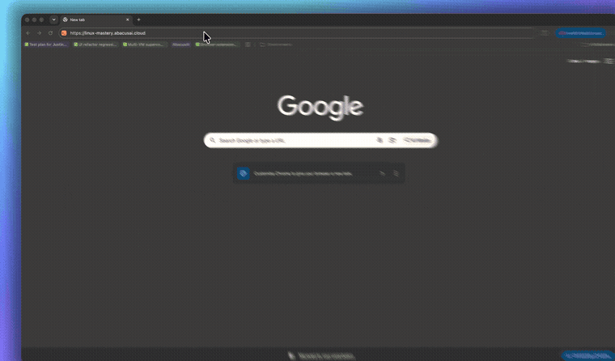

<div align="center">
  

  <h1>&gt;_ Linux Mastery</h1>

  <p><b>Learn the Linux terminal by playing.</b><br/>
  A browser game where you type real shell commands, watch the file tree react, and earn XP with Maya, your first-day teammate.</p>

  <!-- ▶️ Live demo (temporary preview) — add the hosted URL here when available, e.g.:
       <p><a href="https://your-temp-host"><b>▶️ Play Linux Mastery</b></a></p> -->

  <p>
    <a href="#features">Features</a> ·
    <a href="#roadmap">Roadmap</a> ·
    <a href="#getting-started">Getting started</a> ·
    <a href="#project-structure">Project structure</a> ·
    <a href="#contributing">Contributing</a>
  </p>

  <p>
    
    
    
    
    
  </p>
</div>

<p align="center">
  
</p>

---

## 💡 Inspired by

This project is inspired by [**Git Mastery**](https://gitmastery.me/) by [Mika Stiebitz](https://github.com/MikaStiebitz) — an interactive browser game that teaches Git through hands-on terminal challenges. We loved the concept and UI/UX so much that we built Linux Mastery on the same stack and design patterns, adapted for the Linux terminal.

👉 Check out the original: [github.com/MikaStiebitz/Git-Mastery](https://github.com/MikaStiebitz/Git-Mastery)

---

## 🐧 What it is

Most Linux tutorials are something you read. Linux Mastery is something you **play**.

```console
explorer@linux:~$ mkdir projects
explorer@linux:~$ cd projects
explorer@linux:~/projects$ touch notes.txt          ★ +50 XP
```

Each mission runs a simulated shell in your browser. You type real commands into a terminal, the
filesystem panel updates as you go, and nothing you break is real. Guest progress is saved in
`localStorage`. You can also create an optional local account to keep progress on the server.

<a id="features"></a>

## ✨ Features

|                           |                                                                                       |
| ------------------------- | ------------------------------------------------------------------------------------- |
| 🖥️ **Simulated shell**    | `pwd`, `ls`, `cd`, `mkdir`, `touch`, `cat`, `echo` with `>`/`>>`, `cp`, `mv`, `rm`, `chmod`, pipes (`\|`) with `grep`, `cut`, `sort`, `uniq`, `wc` and more |
| 🌳 **Live file tree**     | The Filesystem tab redraws the virtual filesystem after every command                |
| 📖 **Maya's story**       | Every mission opens with a story briefing and a real-world use case                   |
| 🎯 **Structured path**    | Twenty-three missions across five stages: *Find your way*, *Make it yours*, *Work with files*, *Lock it down*, *Pipes & text* — with more on the way |
| ✅ **Challenge panel**    | Objective checklist, step-by-step hints and a concept explainer for each mission      |
| 🎮 **Playground**         | A free sandbox with no goals                                                          |
| 📚 **Field Guide**        | A searchable cheat sheet of every supported command                                   |
| 📈 **XP and ranks**       | XP per mission, a rank that grows with progress, and confetti when you finish a mission |
| 🔐 **Local accounts**     | Optional email/password accounts (Python + SQLite); you can bring guest progress into a new account |
| ⌨️ **Terminal comforts**  | Command history (↑/↓), Tab completion, `Ctrl+L` to clear, `Ctrl+C` to cancel           |

<a id="roadmap"></a>

## 🗺️ Roadmap

Linux Mastery has twenty-three missions across five stages today, most recently **Pipes & text**.
Up next: **Beginner/Intermediate/Advanced** difficulty tiers, **concept visualization cards**, and
**live hosting**.

See the full plan in **[ROADMAP.md](./ROADMAP.md)**.

## 🛠️ Tech stack

**Next.js 16** (App Router, static export) · **React 19** · **TypeScript** · **Tailwind CSS 4** ·
**Radix UI** · **GSAP** (with ScrollTrigger) · **Lucide** icons · **Geist** fonts · **Vitest**.

The shell simulation, mission engine and progress system are written from scratch. State lives in
React Context (`GameContext`, `AuthContext`) and `localStorage`. The only backend is the optional
account API in [`server.py`](./server.py), built on Python's standard library and SQLite. It serves
the static export and adds `/api/*` routes, and the game works fully without it.

UI and UX follow [GitMastery](https://github.com/MikaStiebitz/Git-Mastery). The Linux identity is
kept: orange/aubergine palette, the penguin, Maya, the Field Guide, and `>_` branding. Design tokens
(`--color-lm-*`) are defined in [`src/styles/globals.css`](./src/styles/globals.css).

<a id="getting-started"></a>

## 🚦 Getting started

Requires **Node 20+** (22 recommended). **Python 3.10+** with scrypt support is needed only for accounts.

```bash
git clone https://github.com/Vijaybv-11/linux-mastery
cd linux-mastery
npm install
npm run dev            # http://localhost:3000 (UI only, no accounts)
```

To run the full app with local accounts:

```bash
npm run serve          # next build → out/, then python3 server.py
# open http://localhost:5173
```

| Command                 | What it does                                                    |
| ----------------------- | --------------------------------------------------------------- |
| `npm run dev`           | Next.js dev server with hot reload                              |
| `npm run build`         | Static export to `out/`                                         |
| `npm start`             | `python3 server.py`: serves `out/` (or legacy `dist/`) plus the account API |
| `npm run serve`         | Build, then start the account server                            |
| `npm run lint`          | ESLint (flat config, `eslint-config-next`)                      |
| `npm run format`        | Prettier over the repo                                          |
| `npm test`              | Vitest in watch mode                                            |
| `npm run test:run`      | Vitest once, the way CI runs it                                 |
| `npm run test:accounts` | Python integration tests for the account API (temporary database) |

### Server options

- `python3 server.py --port 5174` uses a different port.
- `python3 server.py --public-origin https://<exact-host>.trycloudflare.com` is for a temporary
  Cloudflare Tunnel preview. Only that exact hostname is allowed, and cookies become `Secure`.
- The server binds to `127.0.0.1`. Accounts live in `.data/accounts.sqlite3`, which Git ignores;
  keep it private.

<a id="project-structure"></a>

## 🗂️ Project structure

```text
src/
├── app/                        # Next.js App Router
│   ├── layout.tsx              # Fonts, providers, Navbar/Footer, global dialogs
│   ├── page.tsx                # Home: hero, ticker, player HUD, journey path (GSAP)
│   ├── mission/[id]/page.tsx   # Statically generated mission pages (1–23)
│   ├── playground/page.tsx     # Free-play shell
│   └── not-found.tsx           # Terminal-style 404
├── components/
│   ├── home/HeroDemo.tsx       # Animated demo terminal + penguin
│   ├── layout/                 # Navbar, Footer, Overlays (toast, confetti)
│   ├── workspace/              # Workspace, Terminal, FileTree, ProgressBar,
│   │                           # RequirementChecklist, StoryDialog
│   ├── FieldGuideDialog.tsx    # Searchable command reference
│   ├── AccountDialog.tsx       # Login / sign-up
│   └── ui/                     # Radix-based primitives (button, dialog, tabs, …)
├── contexts/
│   ├── GameContext.tsx         # Sessions, progress, XP, hints, dialogs
│   └── AuthContext.tsx         # server.py accounts + remote progress saves
├── lib/
│   ├── shell.ts                # Simulated shell + virtual filesystem
│   ├── lessons.ts              # Missions, Maya's scenarios, checks, groups
│   ├── progress.ts             # Progress schema, sanitising, ranks
│   ├── fieldGuide.ts           # Field Guide content
│   └── utils.ts                # cn() helper
├── styles/globals.css          # Tailwind v4 theme tokens + utilities
└── test/                       # Vitest suites (gnu-parity.test.ts diffs text commands against GNU coreutils)
docs/                           # Per-stage notes on why each mission matches real Linux behaviour
server.py                       # Static server + local account API
tests/test_server.py            # Account API integration tests
```

### Adding a mission

1. Add a `Lesson` to `lessons` in [`src/lib/lessons.ts`](./src/lib/lessons.ts). Give it a `scenario`
   (Maya's story), `objective`, `concept`, two `hints`, `xp`, and a `check(state, event)` function.
2. Add its index to a stage in `groups`.
3. If it needs a new command, implement it in [`src/lib/shell.ts`](./src/lib/shell.ts) and document
   it in [`src/lib/fieldGuide.ts`](./src/lib/fieldGuide.ts).
4. Add a test in `src/test/` that the mission starts unsolved and is solved by the intended commands.

Mission pages are generated from `lessons` automatically.

<a id="contributing"></a>

## 🤝 Contributing

Pull requests are welcome, especially new missions and shell commands.

1. Fork the repository.
2. Create a branch: `git switch -c feature/amazing-feature`.
3. Make your changes, then run `npm run lint`, `npm run test:run` and `npm run build`.
4. Commit, push, and open a pull request.

Keep the Linux theme: the `lm-*` tokens, the penguin, Maya's voice and the `>_` brand mark.
UI components should stay consistent with the existing Radix primitives in `src/components/ui/`.

## 🔒 Accounts and privacy

- Passwords are stored as salted scrypt hashes.
- Sessions are random tokens in HttpOnly, SameSite=Strict cookies. They expire after seven days
  and are invalidated on logout. Only token hashes are stored.
- The server checks request origin and hostname, and rate-limits repeated login attempts.
- These are local accounts only: there is no email verification and no password reset. Public
  hosting would need a production server, HTTPS and a recovery flow.

## ⚠️ Scope

The terminal is an educational simulation, not an operating system. The supported syntax is listed in
the in-app Field Guide. Each mission has its own workspace, and resetting a mission keeps the XP you
earned. Pipes work, but other shell syntax (`;`, `&&`, `<`, `2>`) and processes, services and networking
are outside the current chapter.

---

<p align="center">
  Visual and learning inspiration: <a href="https://github.com/MikaStiebitz/Git-Mastery">GitMastery</a>.
  Linux Mastery uses original source and assets.
</p>
